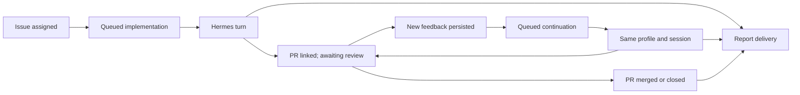

# Assigned ticket → PR → feedback continuation

Status: six sequential, releasable PRs. Iteration 1 implementation and automated
validation are complete on `feat/assignment-routing`; live acceptance is pending
disposable GitHub, Linear, and Hermes targets. Iterations 2–6 remain planned.
The sections below describe the target design, not a claim that all behavior exists.

Iteration 1 validation: full build, package typechecks, lint and 627 tests passed;
the final compatibility regression and discovery checks passed (24 focused tests,
including one additional test). CLI package dry-run passed. Live tracker/Hermes
acceptance and the Node 22/24 CI matrix must pass before release.

## Outcome

Assign a Linear or GitHub issue to a configured Hermes bot. Sentinel0 starts that
agent, Hermes implements the task and opens a PR, and the originating issue receives
the PR link and validation evidence. Feedback from people or other bots starts a new
turn in the same Hermes session. The agent fixes valid critical findings or explains
why it disagrees, pushes to the existing branch, and reports the result to the issue.

The workflow remains observable and recoverable across restarts, busy agents, duplicate
observations, and temporary failures. This is a product capability with automated
acceptance tests and a live acceptance exercise before rollout.

## Boundaries and decisions

- Hermes continues to own repository access, worktrees, implementation, commits, PR
  creation, and substantive replies to PR feedback.
- Sentinel0 owns assignment routing, workflow ownership, event delivery, session
  selection, artifact references, lifecycle, and reliable reporting to the source issue.
- Both issue providers enter the same workflow. PRs and their feedback live on GitHub.
- Use polling initially, with pagination and durable event tracking. No new inbound
  runner endpoint is required. Webhooks can feed the same event inbox later.
- A new workflow is opt-in per project. Existing routes retain their current behavior;
  a workflow-owned issue/PR must not also start an ordinary implementation route.
- Current assignment is the intake condition. An assigned issue observed after downtime
  must be eligible even if Sentinel0 never observed the assignment transition.
- One workflow retains one owning runner/profile and one Hermes session. Never pick
  the profile's most recent session: unrelated tickets must remain isolated.
- The initial implementation supports one repository and one active PR per workflow.
  Reject ambiguous repository selection or multiple candidate PRs visibly. Multi-PR
  work is a later extension, not something inferred from free-text summaries.
- Automatic PR merging is outside this change. Observe merge/closure and conclude the
  workflow; leave merge policy to the team.
- The agent policy defines criticality. Every delivered finding receives a recorded
  disposition, including noncritical findings and disagreements, so silence is not
  confused with a lost event.

## Current implementation to extend

| Area | Existing foundation | Required extension |
|---|---|---|
| Identity and intake | GitHub assignees; profile and GitHub login targets | Linear user IDs, repository binding, assignment intake for both providers |
| Dispatch | Route matching, run records, one active local run per profile | Durable workflow ownership and queued turns |
| Hermes | Adapter accepts `sessionId`; runs store `hermesSessionId` | Select and persist the workflow session; safe creation retries |
| PR monitoring | Open PR metadata and requested reviewers | Reviews, inline comments, conversation comments, PR lifecycle and check evidence |
| Reporting | Short agent summary posted to trigger item | Structured PR/evidence references and durable source-issue report delivery |
| Recovery | Attach to a live Hermes run; cloud mirror outbox | Recover pending turns, submission ambiguity, reports, and workflow state |
| UI | Run lists, approvals, routes, integration setup | Workflow history, pending feedback, evidence, blocked reasons and recovery actions |

Relevant source: `packages/common/src/index.ts`, `route-validation.ts`,
`route-catalog.ts`; `packages/orchestrator/src/linear/service.ts`,
`github/service.ts`, `routing/dispatcher.ts`, `hermes/adapter.ts`, `database.ts`,
`index.ts`; and the cloud API, migrations, dashboard and CLI packages.

## Workflow and persistence model



Keep work state separate from run state. A completed implementation run can leave the
work awaiting review. An unanswered Hermes approval occupies the profile but does not
end the workflow. A report delivery failure does not erase a successful code change.

Proposed records, with shared versioned types and additive SQLite/Postgres migrations:

- **Work:** stable ID, organization, source provider and immutable issue ID, tracker
  scope (Linear workspace or GitHub repository), source project/ref/URL, repository,
  assigned identity, owner runner/profile, Hermes instance/session, lifecycle state,
  blocked reason, current PR/head SHA, and version/timestamps.
- **Artifacts:** work ID, type, URL, repository/PR identity or commit SHA, reporting
  turn, evidence source, observation time, and validation status. Store references
  and bounded summaries; large artifacts stay with their existing host.
- **Feedback inbox:** provider event ID and revision, PR identity, author identity,
  event kind, parent review/thread, file/line and commit context, body, timestamps,
  processing state, batch/turn assignment, disposition and response reference.
- **Turns:** work ID, purpose, immutable prompt snapshot, feedback batch, run ID,
  attempt, submission key, Hermes run/session IDs, and execution state.
- **Report outbox:** logical report key, destination provider/issue, payload version,
  remote comment ID, delivery state, retry schedule and last error.

Cloud atomically arbitrates initial work ownership using the organization, provider,
tracker scope and immutable issue ID. It must not depend on a route or project ID:
overlapping project filters must not create two owners. The owning runner keeps the
durable execution inbox/turn/outbox in SQLite and mirrors versioned state to the cloud.

The owning runner may continue already-owned work during a cloud outage. Newly
observed work waits until its ownership claim can be confirmed. Staleness alone never
transfers ownership to another runner. Transfers require the previous owner to be
quiescent and the destination to have a verified usable session; otherwise show a
blocked transfer. Enforce one registered owner per configured Hermes instance/profile.

## Release iterations: one PR per iteration

These are sequential releases: each depends only on previously merged and released
iterations. Each PR includes the implementation, migrations, usable CLI/dashboard
surface, tests, documentation and release notes for its capability. There is no
separate final testing or documentation PR, and no requirement to ship all six at once.
PR titles below are proposed titles, not already-created pull requests.

| Iteration | Proposed PR title | What the released version lets an operator do |
|---|---|---|
| 1 | `feat: route Linear and GitHub issues by agent assignment` | Assign either kind of issue and get an initial agent run and its existing summary |
| 2 | `feat: persist assigned work ownership and queued turns` | Keep assigned work through contention/restarts and see who owns it |
| 3 | `feat: link implementation PRs and reliably report evidence` | See the verified PR/evidence on the source issue, with retryable reporting |
| 4 | `feat: continue tracked work in its original Hermes session` | Manually ask for another turn on the same ticket, PR and session |
| 5 | `feat: address PR feedback automatically in the owning session` | Have human/bot review feedback evaluated and addressed automatically |
| 6 | `feat: complete workflow lifecycle and recovery controls` | Follow checks through completion and manage merge/closure, reopening and handoff |

The assignment → PR → automatic review-feedback loop is available after iteration 5.
Iteration 6 completes ongoing evidence updates and lifecycle/recovery operations.
Basic safeguards and recovery required by an iteration ship in that iteration.

### Iteration 1 — Assignment works on both providers

**Ship:** Linear user identity on profiles, Linear assignee collection, paginated issue
intake, explicit Linear-project repository context, and validated assignment route
templates for both providers. Reuse the existing dispatch and summary-comment path.
Expose setup/preflight, route creation and agent identity display in the same PR.

Use current assignment plus existing once-only guards for the initial implementation
run. An assignment observed after downtime is eligible. For this first release,
document one designated runner per watched project/profile: distributed ownership
arrives in iteration 2. Assignment starts an ordinary run; it does not claim to
establish session continuation or verified PR tracking yet.

**Main changes:** common types/config/validation/catalog; Linear and GitHub collectors;
CLI initialization/preflight; cloud inventory and project configuration; dashboard
setup; relevant setup, routes, API and CLI docs.

**Release gate:** Linear and GitHub assignment tests select the correct profile and
repository, ignore unmapped identities, work beyond page one and after downtime, and
do not repeat on unchanged observations. Existing label/reviewer routes still pass.
Exercise one initial live run per provider, including the existing summary comment.

**Rollback:** disable the new assignment routes; existing routes and configuration
remain readable. Identity and repository fields are optional for older configurations.

### Iteration 2 — Assigned work is durable and has one owner

**Ship:** opt-in tracked assignment mode with work records, cloud ownership arbitration,
a persistent local turn queue, run/work links and minimal work list/detail views.
Busy agents and pending approvals leave work queued. Persist the first Hermes session
and an immutable turn submission key, and recover accepted submissions after restarts.
An initial turn can finish with the work idle, ready for a later continuation.

Enforce project-independent source identity, organization isolation, runner addressing
and one owner per Hermes instance/profile. New claims wait through cloud outages;
confirmed owners can continue locally. Prevent legacy routes from starting parallel
implementation runs for tracked items. Disabling/reassigning the agent pauses the work
visibly; automatic transfer is unavailable until the later recovery controls.

**Main changes:** common work/turn contracts; SQLite and Postgres migrations; cloud
claim/mirror APIs; dispatcher/queue/recovery; Hermes submission handling; minimal
dashboard/CLI ownership and queue diagnostics. Introduce real-Postgres and file-backed
SQLite integration tests in this PR.

**Release gate:** two runners/overlapping projects produce one work owner and initial
run; two issues sharing a profile execute serially; queued work and session identity
survive a real process restart; lost submission responses reconcile without another
run; wrong-organization/runner calls fail. Verify the deployed Hermes idempotency
contract before enabling automatic submission retries.

**Rollback:** stop new tracked intake and pause its pending turns; keep claims and
queue records. Reconcile live turns before downgrading. Do not convert tracked items
back to ordinary routes automatically, which could restart their work.

### Iteration 3 — The PR and evidence reach the original issue reliably

**Ship:** validated structured agent results, verified ticket/work → PR/branch/head
links, initial evidence collection, and a persistent report outbox. Hermes opens the
PR and returns its identifiers; Sentinel0 verifies it and posts the report to the
correct Linear or GitHub issue. Show artifacts, check status and delivery failures
in work detail, with report-only retry available in both API and operator tooling.

Add deterministic PR correlation and recovery when PR creation precedes a crash.
Record code-host checks against the exact head SHA and distinguish them from
agent-reported test results. Pending checks remain pending; continuous report refresh
ships in iteration 6. Add basic linked-PR closure detection now so later continuations
can refuse work on closed/merged PRs. Incomplete/malformed results remain visible and
recoverable without blindly repeating the implementation.

**Main changes:** result contract/parser; artifact storage/APIs; GitHub PR/check lookup;
cross-provider report addressing; durable tracker outbox; workflow detail UI and docs.

**Release gate:** both providers receive the verified PR link and evidence under the
configured reporting identity; unrelated/multiple candidate PRs are rejected; a crash
after PR creation does not create another PR; report retry survives restart/outage;
a lost comment response is reconciled before creating another comment. Retrying a
report never starts Hermes, and evidence from an old SHA is not marked current.

**Rollback:** stop new tracked intake/turns while preserving artifact bindings and
pending reports. Keep report delivery available or paused for deliberate retry. Older
ordinary runs keep their summary-only output contract.

### Iteration 4 — Manual continuation proves session reuse

**Ship:** a “Continue work” action in the work detail view and a CLI/API equivalent.
An operator supplies feedback; Sentinel0 queues a turn on that work's original runner,
profile, session and PR, then reports the outcome through iteration 3's outbox.

Pass the saved session explicitly and verify repository/branch/head context before
work resumes. Missing sessions block visibly; never select the profile's latest
session or silently start a fresh conversation. Manual continuation uses the durable
queue, existing approval/cancellation flow and stable submission keys. Refuse closed
PRs, paused work and ambiguous ownership. Automatic review ingestion remains disabled.

**Main changes:** continuation command/API; dispatcher session selection and context;
dashboard/CLI action; session-aware fake Hermes; command addressing and diagnostics.

**Release gate:** a live second turn recalls first-turn context, produces a new run ID
with the same session ID, updates the same PR and reports back to the original issue.
Two tickets cannot share context accidentally. Cover busy/approval, restart, missing
session, duplicate command delivery, changed head and closed-PR cases.

**Rollback:** disable continuation commands and pause unstarted continuation turns;
initial tracked work and report delivery still function. Preserve the session mapping.

### Iteration 5 — Automatic feedback from humans and bots

**Ship:** opt-in feedback monitoring on linked PRs, a durable feedback inbox, bounded
batching, and automatic continuation through iteration 4. Collect human reviews,
inline comments/replies and conversation comments, plus the actual surfaces used by
`baz-reviewer`. Apply the agent's versioned criticality policy, record each finding's
disposition and return evidence-backed replies or code changes on the existing PR.

Pagination, edited feedback, self-event suppression, pending feedback while busy,
current-head/thread revalidation, partial-side-effect recovery, bounded retries and
rate-limit handling are release requirements here. A merged/closed PR or reassigned
issue stops new automatic continuations. Include enable/disable/pause controls,
pending-feedback and disposition visibility, and actionable blocked reasons now.

**Main changes:** GitHub feedback collectors; durable inbox/cursors; batch scheduler;
continuation prompt/policy/result contracts; PR context checks; cloud/dashboard
feedback history and controls; provider-neutral source reports.

**Release gate:** the full automatic flow passes for a Linear-origin issue and a
GitHub-origin issue. A human and real `baz-reviewer` exercise fixed critical findings,
evidenced disagreement and noncritical dispositions. Confirm the same profile/session,
one PR, no self-trigger loop, no lost feedback while busy, no repeat of unchanged
feedback, and successful recovery through process/tracker outages. Prove the
full-path test in CI; do not defer it to iteration 6.

**Rollback:** disable automatic feedback dispatch but retain its inbox. Initial work,
manual continuation and reporting remain usable; unprocessed feedback stays visible.

### Iteration 6 — Lifecycle completion and operational recovery

**Ship:** ongoing check/evidence refresh for the relevant commits, final merge/closure
reports, explicit reopen/resume behavior and recovery/handoff controls. Add optional
mapping of verified PR lifecycle to Linear/GitHub issue state; leave automatic issue
closure disabled by default. Complete work history and queue/report diagnostics.

Basic closure stopping, safe blocking and report/turn recovery already shipped in
earlier iterations. This release makes the remaining lifecycle operations usable:
resume deliberately after reopening, recover a lost session with an explicit new
session decision and preserved artifact context, or transfer only after the old
owner is quiescent and the destination can use the intended session. Never imply
that Hermes sessions are automatically portable across profiles or machines.

**Main changes:** lifecycle reconciliation and evidence refresh; source-state mapping;
recovery/transfer commands and ownership checks; workflow timeline and diagnostics;
complete operational docs and the expanded acceptance suite.

**Release gate:** merge/close/reopen, late check completion, unassignment/reassignment,
profile removal, blocked transfer, approved session replacement, long-lived work and
mixed-version deployment cases pass. Run the complete live acceptance matrix and
verify each release's rollback retains enough state to resume safely.

**Rollback:** disable lifecycle state writes and new recovery actions; retain their
audit history and bindings. Evidence reporting and earlier capabilities continue on
the compatible cloud schema. Never restore a previous owner blindly.

### Definition of releasable for every PR

1. The advertised capability works from configuration to visible result on the
   currently released dependencies. No operator-facing button points at future work.
2. Tests for normal behavior, failure/recovery and relevant regressions pass; necessary
   Postgres, restart and live contract checks belong to that PR's release gate.
3. CLI/dashboard/API configuration and docs ship together. Release notes state which
   stages of the full workflow are available and any supported operating limits.
4. Schema changes are additive and old clients remain supported. If a runner cannot
   support a new mode, registration/config validation prevents it from consuming that
   work. Test the mixed-version window, not just the final all-upgraded deployment.
5. Deploy compatible cloud migrations/API first, then runner/CLI and dashboard; enable
   the new capability on a test project after its checks pass. This ordering happens
   within each release, without depending on a later PR.
6. The PR records rollout and rollback actions, retained state and active-run handling.
   Reconcile active work before downgrade; disabling a feature must not delete work.

## Technical work packages

These packages describe implementation detail, not additional PRs. The iteration
boundaries above take precedence. Allocate them as follows:

| Work package | Release allocation |
|---|---|
| A: external contracts | Credentials/intake in 1; idempotency in 2; evidence in 3; session in 4; real bot feedback in 5 |
| B: identity and intake | 1 |
| C: ownership and queue | 2; usable transfer/reopen recovery in 6 |
| D: Hermes and artifacts | Submission/session persistence in 2; PR/evidence in 3; session continuation in 4 |
| E: PR observations | PR identity/check lookup and closure checks in 3; feedback in 5; full lifecycle refresh in 6 |
| F: feedback continuation | Manual turn infrastructure in 4; automatic policy-driven turns in 5 |
| G: source reporting | Durable reports in 3; per-turn use in 4–5; ongoing/final lifecycle updates in 6 |
| H: operator surfaces/docs | Included with each owning iteration |
| I: validation/rollout | Included with each owning iteration; complete matrix in 6 |

### A. Establish the executable contracts

- Verify the deployed Hermes version can continue an existing session through
  `POST /v1/runs`, including after a gateway restart. Capture scrubbed request/response
  fixtures for session IDs, run IDs, terminal output and approval states.
- Verify support for run-creation idempotency and its retention window. Require a
  compatible version for automatic ambiguous-submission recovery; do not silently
  retry a possibly accepted request against a server without that support.
- Record the actual output surfaces used by `baz-reviewer`: formal reviews, inline
  comments, regular PR comments, edits, or check annotations. Implement the surfaces
  it actually uses as well as normal human reviews; do not assume all bots submit
  `CHANGES_REQUESTED` reviews.
- Verify bot access to the selected repository and Linear workspace. Separate the
  Hermes execution identity from the credential Sentinel0 uses for tracker reporting.
  Use a bot-owned reporting credential when reports must appear as that bot.
- Decide the initial profile policy text for criticality, evidence and disagreements;
  record its version with each turn. Do not silently rewrite the installed `SOUL.md`.
- Restore or locate the `add-tests` and `update-docs` skills referenced by `AGENTS.md`
  before implementation. Their files were absent when this plan was written.

Gate: a real two-turn Hermes experiment recalls a fact from turn one in turn two,
keeps the same session, and produces distinct run IDs. Provider fixtures match live
payloads. Missing capability is a visible deployment prerequisite.

### B. Add identities and provider-neutral assignment intake

- Add optional Linear workspace/user identity to profile configuration, discovery,
  cloud inventory, CLI initialization/preflight, and the agent display. Match immutable
  Linear user IDs; display names/emails are labels, not identity keys.
- Fetch Linear assignees and normalize them into trigger data. Extend filters,
  validation and prompt context where needed. Keep GitHub login matching intact.
- Add explicit source-project → GitHub repository binding for Linear work; derive
  it from the issue repository for GitHub work. Keep the source and repository
  credential scopes distinct when selecting clients.
- Add an assignment workflow template/configuration surface. Reject unknown or
  ambiguous agent mappings and missing repository bindings before enabling it.
- Paginate intake queries; do not silently stop at 100 items. On activation, show
  which current assignments are eligible. Re-observation must not start duplicate work.

Gate: assigning either provider's issue selects the intended profile and repository;
assigning a human or an unmapped user starts nothing and has an explainable result.
Already assigned issues are picked up after downtime and beyond the first page.

### C. Persist work ownership and a durable turn queue

- Implement the work/turn schema and atomic initial cloud claim, plus local
  transactions that enqueue work before advancing collection progress.
- Connect workflow dispatch to existing runs with `workId` and turn purpose; preserve
  existing run APIs for ordinary routes. Add organization-scoped ownership APIs and
  runner-addressed commands; ensure polls, acknowledgements and writes check ownership.
- Queue work when its profile is busy or awaiting approval. A busy result must not
  consume an assignment or feedback event. Serialize turns per work/profile and
  maintain the existing global concurrency limit and fair scheduling between tickets.
- Freeze each submitted turn's prompt and feedback batch. Later feedback becomes a
  later pending batch; never mutate an already submitted turn.
- Keep workflow deduplication independent of the current 30-day dispatch-ledger
  pruning. Active work and its feedback must survive long-running PR review cycles.
- Define removal/reassignment behavior: cancel unstarted work, request a safe stop of
  active work, retain history, and require a deliberate transfer for a different
  agent. Route edits/deletion must not silently move an existing workflow's owner.
- Exclude workflow-owned items from overlapping legacy implementation routes. Audit
  project scoping of lapsed-claim cleanup and observation-before-dispatch behavior
  so the new path cannot rearm another project's work or lose a busy transition.

Gate: two runners or overlapping projects observe one issue and only one owns it.
Pending work survives a process restart, cloud outage, profile contention and pruning.
Unrelated organizations and sessions cannot claim or continue it.

### D. Bind the Hermes session and PR artifacts

- Persist the session as soon as Hermes returns it; send it explicitly on every
  subsequent turn. Never substitute a new session when continuation fails. Mark the
  work blocked, with a deliberate recovery option for a deleted/expired session.
- Give each turn a stable submission key and immutable request payload. Reconcile a
  lost create response through Hermes idempotency within its verified retention
  window. After that window, require reconciliation instead of a blind new submission.
- Extend the output contract with a versioned, validated result alongside the readable
  summary: work ID, repository, branch, PR URL/number, head SHA, evidence references,
  and per-feedback dispositions/response references. Parse this outside free-text
  summary extraction; malformed output must not be treated as successful registration.
- Include the work ID and source issue link in the PR metadata. Verify the returned
  PR through GitHub and bind it to the work. Recover a PR created before a crash by
  looking up that correlation marker; multiple matches require reconciliation.
- Capture test commands/results as agent-reported evidence and fetch GitHub check
  status for the relevant head SHA as independently observed evidence. Keep those
  origins visible. Never claim checks passed when pending or for an older commit.

Gate: implementation produces a verified PR link, source issue link, evidence and
session binding. Two tickets handled by the same profile retain separate sessions.
A crash after PR creation cannot silently create a second PR.

### E. Ingest PR feedback and lifecycle changes

- Poll linked PRs for submitted/edited/dismissed reviews, inline comments and replies,
  conversation comments, thread resolution and head changes. Add bot check output if
  the contract checks show the selected reviewer uses it.
- Normalize feedback with source IDs, revision, author, review/thread and commit
  context. Group a review and its inline comments without delivering the same
  finding twice. Bot-authored feedback is eligible; the worker's own acknowledgements
  and report comments are excluded using identity and recorded output IDs.
- Use durable per-stream progress and an overlap window where appropriate; dedupe by
  source ID/revision, not PR `updated_at`. Persist inbox entries and cursor movement
  atomically. Do not advance progress past an unpersisted page after a partial failure.
- Debounce nearby feedback into bounded batches, with a maximum delay so a busy PR
  cannot postpone processing forever. Preserve pending work during rate limits and
  honor provider retry guidance.
- Bootstrap feedback collection when the PR is bound, including feedback that arrived
  before Sentinel0 registered the PR. Recheck current thread/head state before execution.
- Fetch linked PRs by identity after they leave the open-PR list. Merge closes the
  work as merged; closure without merge records that outcome and cancels unstarted
  continuations. Reopening requires an explicit resume policy, retaining the same work.

Gate: human and bot feedback of each supported kind produces one durable item per
revision; edits are seen, resolved/outdated findings are not blindly acted on, and
feedback arriving during an active turn is processed afterward.

### F. Continue work under the agent's feedback policy

- Resolve feedback to its existing work owner, and create a new run in the bound
  session with the source issue, verified PR/branch/head, and pending feedback batch.
- Ask the agent to assess each finding against the current code. Record dispositions
  such as fixed, rejected with evidence, noncritical, already resolved or needs a
  human decision. Criticality is policy-driven; reviewer wording alone is not proof.
- For accepted critical findings, instruct Hermes to change the existing branch,
  validate, push, and reply to the relevant review thread. For disagreement, require
  a concrete explanation and evidence. Preserve the same PR throughout the cycle.
- Compare the head before acting/pushing; reconcile concurrent human changes using
  Hermes' repository workflow. Report conflicts rather than overwriting someone
  else's work. A reused conversation does not prove its old worktree is still current.
- Preserve existing approval/cancel semantics. Do not treat an approval from a prior
  run as blanket permission for future turns; honor what the deployed Hermes policy
  actually requires.
- Mark only explicitly dispositioned feedback as handled. On failure, retain the
  batch and reconcile partial pushes/replies before retrying. Include bounded retry
  and repeated-disagreement handling, ending visibly blocked when progress needs help.

Gate: a valid critical finding causes a commit and reply; an invalid finding produces
an evidence-backed disagreement; noncritical feedback produces no unnecessary code
change. All use the same profile/session, and none of the replies triggers a loop.

### G. Deliver complete evidence to the source issue

- Add a durable tracker-report outbox, separate from the cloud mirror. Enqueue the
  report with the local turn outcome in one transaction. Report delivery and execution
  status remain separate and independently retryable.
- Address the original issue using its stored provider and immutable identity. A
  GitHub PR feedback turn on Linear-origin work must still report to Linear.
- Publish the PR link, relevant commit, check/test evidence, feedback dispositions,
  unresolved questions and next state. Use the same report shape for GitHub issues.
- Store remote comment IDs and deterministic report markers. Reconcile an ambiguous
  POST before retrying; use provider idempotency if available. Document the residual
  ambiguity when a provider cannot support atomic idempotent creation.
- Use one logical report per turn and update it when check evidence settles for that
  turn's head SHA. Refreshing evidence must not start another coding turn.
- Retry transient failures with backoff; show permanent credential/permission errors
  and allow report-only retry without rerunning Hermes. Announce merge/closure to the
  source issue; do not equate an opened PR with a completed issue.
- Keep automatic source-issue closing/state changes opt-in. Default to reporting the
  verified PR lifecycle without overriding the team's tracker workflow.

Gate: reports arrive on the correct issue, under the configured reporting identity,
with current evidence. An outage or restart does not lose a report or rerun the code.

### H. Make the workflow operable and document it

- Add cloud APIs and dashboard views for work, linked runs/PR, session identity,
  pending feedback, dispositions, evidence and report delivery errors.
- Extend CLI diagnostics to explain assignment routing, ownership, queued turns,
  missing sessions, and delivery failures. Provide deliberate pause/resume, retry-turn
  and retry-report actions with distinct behavior and runner-addressed commands.
- Validate identity/repository configuration in setup and expose the distinction
  between agent credentials and Sentinel0 reporting credentials. Do not require
  operators to understand internal event IDs to run the workflow.
- Update `README.md`, `docs/getting-started.md`, `docs/routes.md`, `docs/api.md`,
  `docs/dashboard.md`, `docs/deploy-cloud.md`, `docs/releasing.md`, and the CLI README
  where affected. Correct contradictory setup/routing guidance in those paths and
  `CONTRIBUTING.md`; update architecture notes in `CLAUDE.md`.
- Add a worked Linear example, equivalent GitHub example, bot review-policy example,
  required credentials/capabilities, lifecycle semantics, offline behavior and recovery.

Gate: an operator can configure and follow both workflows from documented setup,
see why work is waiting, and retry reporting without repeating implementation.

### I. Prove each release and roll it out gradually

- Extend existing suites near changed behavior. Add a focused Linear collector suite
  and workflow integration suites; reuse the fake Hermes server and dashboard fixtures.
- Make fake Hermes session-aware and idempotency-aware, including lost responses,
  approvals, deleted sessions and restarts. Add verified contract fixtures so the
  fake cannot merely repeat assumptions from the client.
- Add a CI job with disposable real Postgres for migrations, ownership races,
  organization isolation, addressed commands and mirror/outbox behavior. Existing
  SQL-string mocks alone cannot prove these properties. Use file-backed SQLite for
  process-restart tests; a second object using one in-memory connection is insufficient.
- Add deterministic full-path tests: provider observation → durable work/turn →
  Hermes → PR registration → feedback → same-session continuation → source report.
  Use controllable fake tracker servers and the real internal APIs/databases.
- Run a live acceptance exercise on disposable Linear and GitHub issues, a test
  repository and the deployed Hermes profile. Include one human review and a real
  `baz-reviewer` review, then compare every external artifact with the stored history.
- For each iteration, ship additive migrations and backward-compatible cloud APIs
  first, then compatible runners and dashboard/CLI. Enable one test project, then
  one production project. Monitor queue age, duplicate submissions, session
  continuity and report delivery.
- Rollback disables new workflow intake and pauses unstarted continuations without
  deleting ownership, feedback or reports. Reconcile active Hermes turns before
  downgrading their runner; keep the additive schema for recovery.

Gate: each iteration's relevant acceptance cases pass before its release; the whole
matrix passes for the completed capability. Record versions, commands, observed
artifacts and failures/fixes. Do not describe a mocked integration pass as proof of
live behavior.

## Required acceptance matrix

| Scenario | Expected proof |
|---|---|
| Linear assignment | Correct user/profile/repository; one work and initial turn |
| GitHub issue assignment | Same workflow behavior and report format as Linear |
| Already assigned while runner offline | Picked up after recovery without needing reassignment |
| More than one page of issues/comments | Eligible items and feedback beyond page one are processed |
| Duplicate observations; overlapping projects/two runners | One owner, one submitted turn, no duplicate PR |
| Two tickets on one profile | Serialized execution; distinct sessions and PR bindings |
| PR created before process crash | Existing PR recovered; no second PR opened |
| Human requested changes; bot review/comment | Correct feedback batch reaches original profile/session |
| Critical, invalid and noncritical findings | Fix, evidenced disagreement and recorded deferral respectively |
| Edited comment; review plus inline comments | New revision handled without repeating unchanged findings |
| Feedback during a busy turn/approval | Remains durable and runs after profile becomes available |
| Own push/reply/report; unchanged feedback | No extra coding turn |
| Resolved thread, stale finding, concurrent head change | Revalidation and reconciliation before edits/push |
| Lost Hermes create response; expired submission key | Safe replay within contract; visible reconciliation otherwise |
| Missing session; moved/disabled profile | Blocked visibly; no fresh-session or wrong-agent substitution |
| Process/gateway restart mid-turn | Attach/reconcile existing run; preserve session and pending feedback |
| Tracker/cloud outage or rate limit | Durable recovery; ownership preserved; no silent queue loss |
| Report accepted but response lost | Reconcile remote report marker/ID before another creation |
| CI pending/fails/new head | Accurate status tied to SHA; no stale success claim |
| Approval denied/cancel/unassignment/reassignment | Defined stop/transfer behavior with retained history |
| PR merged, closed, reopened | Correct lifecycle and reports; no accidental continuation after closure |
| Cross-org or wrong-runner request | Cannot read, claim, mutate or continue another owner's work |
| Existing routes; mixed cloud/runner versions | Existing routes work; unsupported new workflow rejected visibly |

## Checks and definition of done

Use the existing CI matrix (Node 22.12 and 24) and build before tests so the compiled
package checks run. For implementation changes, run the affected suites first, then:

```bash
pnpm lint
pnpm build
NODE_OPTIONS=--experimental-sqlite SENTINEL0_DB_PATH=memory pnpm test
```

Run the existing per-package `tsc --noEmit` checks as CI does. Add the real-Postgres
and persistent-restart suites as explicit required jobs with isolated databases;
they must not inherit the `memory` override above. Verify the CLI tarball through
the existing clean-install checks when config/shared exports change. Build affected
Docker images before deployment.

Done means both source-provider flows pass the acceptance matrix, the live two-round
review exercise uses one session and PR per work item, failures are visible and
recoverable, existing routes remain covered, and the setup/operation docs match the
shipped behavior. A successful PR-opening demonstration alone does not satisfy this.

## References

- [Hermes Runs API](https://hermes-agent.nousresearch.com/docs/user-guide/features/api-server#post-v1runs):
  existing-session transcript loading and run-creation idempotency. Verify the deployed
  version before releasing the dependent capability rather than assuming it matches
  the current documentation.
- [Linear filtering](https://linear.app/developers/filtering): issue assignee relations.
- [GitHub webhook event taxonomy](https://docs.github.com/en/webhooks/webhook-events-and-payloads#pull_request_review_comment):
  reviews, inline review comments, threads and issue/PR conversation comments are
  distinct surfaces even when collected through polling.
